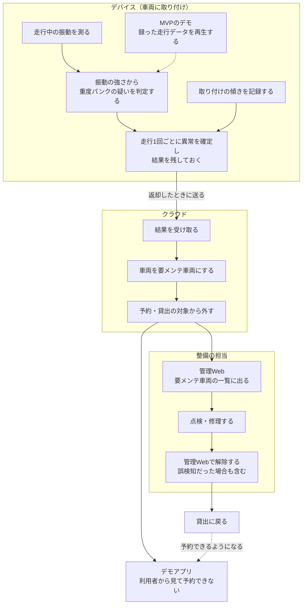

# 企画書：シェアサイクル企業向け「要メンテ車両」自動検知システム

<!-- このファイルはレイアウト（章立てと各章に書くこと）のテンプレート。「書くこと」の説明は、中身を書いたら消す。 -->

## 0. 文書情報

| 項目 | 内容 |
|---|---|
| 資料No. | 01 |
| 版・状態 | 0.4 草案（2〜8章を記入） |
| 更新日 | 2026-11-27 |
| 前提資料No. | なし |
| 承認者 | taiga、kei（承認のルールは 8.2） |
| 関連する作業 | T01（8章）、T03、T04、T05（用語）、T06、T07 |

**区分の書き方**　中身には、必要に応じて【事実】【仮】【推測】【要確認】【未定】を付ける。

---

## 1. 概要

> 書くこと：何を作るか、なぜ作るか、どう進めるか、この企画書で承認を求めること。数行または小さな表にまとめる。他の章を書き終えてから最後に書く。

## 2. 背景と解決する課題

決めた作業：T03（2026-11-27）。詳しい流れと出典は資料07 現状業務分析（`00_全体/07_現状業務分析`）。私たちは対象事業者の関係者ではないため、公開情報と想定から整理している。

### 2.1 背景

- 【事実】対象事業者は HELLO CYCLING（運営：OpenStreet株式会社）とする。電動アシスト自転車を中心としたシェアサイクルで、2025年8月時点で29都道府県・ステーション約11,700か所・車両約5万1,000台を展開している（資料07 2章）。
- 【事実】要メンテ車両を見つける主な手段は、利用者が利用開始後に点検し、不具合をアプリのフォームで申告することである。利用前に気づけば3分以内に返せば料金はかからず、走行中に故障すれば返金される（資料07 4章）。
- 【事実】整備は委託先などのパートナーが行い、巡回してバッテリー交換・再配置・簡単な整備をし、拠点で修理・試乗してからステーションに戻す。巡回のルートはバッテリー残量をもとに組まれている（資料07 4章）。
- 【事実】取材された1拠点では、修理の約半分がパンクで、空気が少ない状態でチューブがこすれて傷むものが多かった。全体の故障率ではない（資料07 4.3）。

### 2.2 解決する課題

| 困っている人 | 困りごと | 区分 |
|---|---|---|
| 利用者 | パンクした車両を借りてしまい、返却して別の車両を探し直す。走行中に気づくと途中で降りて移動しなければならない | 【事実】仕組み／頻度は【要確認】 |
| 利用者 | 空気がほとんどない状態で走ると、段差でのリム打ちなどで転倒につながるおそれがある | 【推測】 |
| 運営（OpenStreet・地域の運営事業者） | 要メンテ車両の発見が利用者の申告頼みで、申告されずに返された車両は次の利用者が借りるまで見つからない | 【事実】申告は任意／見逃しの割合は【要確認】 |
| 運営 | 整備不良の車両が利用の損失を生む。返金と問い合わせへの対応がかかる | 【事実】（堺市の資料・返金の仕組み）／額は【要確認】 |
| 整備の担当（委託先） | パンクを車両側から知る手段が公開情報では見当たらず、巡回で見つかるのを待つことになる。パンク修理が修理の大きな割合を占める | 【事実】巡回の組み方・1拠点の数字／パンクの把握手段は【要確認】 |

このプロジェクトでは、このうち「重度パンクの車両が申告されないまま次の利用者に貸し出される」ことを主に解決する課題とする（T04 で決めた。目的は 3章、スコープは 6章）。

## 3. 目的

決めた作業：T04（2026-11-27）。2.2 の課題のうち、「重度パンクの車両が申告されないまま次の利用者に貸し出される」ことを主に解決する。

| 視点 | 目的 | 対応する課題（2.2） |
|---|---|---|
| 利用者 | 重度パンクの車両を借りてしまう、走行中に気づいて途中で降りる、という困りごとを減らす | 利用者の1行目 |
| 運営 | 要メンテ車両の発見を利用者の申告だけに頼らず、車両の振動から見つける。整備の担当が点検すべき車両を絞り込めるようにする | 運営・整備の担当の行 |
| 安全 | 空気がほとんど入っていない車両を、次の利用者に貸し出すおそれを減らす | 利用者の2行目 |

このプロジェクト（研究・PoC・MVP）で目指すのは、次の2つである。

1. **PoC**：安いセンサーで、重度パンクを走行1回ごとに見分けられるかを確かめる。
2. **MVP**：検知 → 貸出から外す → 点検・修理 → 貸出に戻す、の流れを、デバイス・クラウド・管理Web・デモアプリで一通り動かして見せる。

## 4. 解決策の概要

車両にセンサー付きの小さな機器（デバイス）を取り付け、走行中の振動から、重度パンクの疑いがあるかを判定する。異常判定したら、その結果を車両の中に残しておき、返却したときにクラウドへ送る。クラウドは車両を要メンテ車両にして、貸出除外する（予約・貸出の対象から外す）。整備の担当は管理Webで要メンテ車両を確かめ、点検・修理したあとに解除して貸出に戻す。利用者側から見た変化（予約できない、など）はデモアプリで見せる。

設計の考え方（旧仕様書 第4章を見直したもの）：

- 高価なセンサーで故障を100%見つける仕組みは目指さない。多くの車両に付けられる安さを優先する。
- センサーの判定だけですべてを決めない。利用者の申告と、整備の担当による最終確認と組み合わせて使う前提にする。
- 判定の方式はできるだけ単純にする。複雑な方式（機械学習など）は、単純な方式で目標に届かないことがわかったときだけ検討する。

### 4.1 全体の流れ

図は旧仕様書と同じく「デバイスで判定する」案で描いている。判定をデバイスとクラウドのどちらで行うかは T31、返却時の通信方式は T31・T32 で決める（資料07 6章で Bluetooth を第一候補とした）。

| 構成要素 | 役割 | 担当する領域（8.1） | 決めていないこと |
|---|---|---|---|
| デバイス | 振動を測り、重度パンクの疑いを判定し、結果を残しておく。取り付けの傾きを記録する。返却時に結果を送る | デバイス、データ・検知 | 判定の置き場所（T31）、取り付け位置（T15・T35） |
| クラウド（Firebase の予定） | 結果を受け取り、車両の状態を要メンテ車両に変える。自分たちで用意する予約の仕組みで、予約・貸出の対象から外す | クラウド・API | 通信のつなぎ方（T32） |
| 管理Web | 要メンテ車両の一覧と状態を表示する。点検後に解除して貸出に戻す | 管理Web・デモアプリ | 画面と権限（T37） |
| デモアプリ | 利用者側から見た変化を見せる。HELLO CYCLING の利用者向けアプリは使えないため、模擬する | 管理Web・デモアプリ | 見せる内容（T38） |

### 4.2 ほかの方法との比較

| 方法 | 良い点 | 弱い点 |
|---|---|---|
| 今のまま（利用者の申告と巡回） | 費用が増えない | 申告は任意で、申告されずに返された車両は次の利用者が借りるまで見つからない【事実】（資料07 L1・L2・L5） |
| 申告を増やす工夫（返却のときにアプリでタイヤの具合を聞く など） | 機器が要らず安い | 利用者の手間が増える。気づかない人・答えない人には効かない【推測】 |
| 巡回での空気圧点検を増やす | 人が確かめるので確実 | ステーション約11,700か所・車両約5万1,000台（資料07 2章）をこまめに回るには人手がかかる【推測】 |
| 車輪ごとに空気圧センサーを付ける（自動車のタイヤ空気圧監視システム（TPMS）のような方式） | 空気圧を直接測れる。軽度の減りもわかる | 前後輪それぞれに機器が要り、タイヤやチューブの交換のたびに付け直す手間がある【推測】。シェアサイクルでの使われ方は【要確認】 |
| **本企画（車体の振動から判定する）** | 車体に1つ付けるだけで、後から付けられる。安い部品で作れる見込み【推測】 | 空気圧を直接は測らないので、見逃しと誤検知が出る。わかるのは重度パンクだけ。取り付けがずれると見逃す |

- **タイヤ空気圧監視システム（TPMS）**：タイヤの空気圧をセンサーで測り、低くなると知らせる仕組み。自動車で使われている。

## 5. 期待する効果

| 効果 | 測り方 | PoC・MVP で測れるか |
|---|---|---|
| 重度パンクの車両が、次の利用者に貸し出されにくくなる | 重度パンクの走行のうち、異常と判定できた割合（検知率）。利用を重ねたときに検知できる割合 | PoC で測れる。ただし実験の条件（車両・ライダー・コース）での値で、実際の貸出がどれだけ減るかは測れない（資料04 K-002） |
| 申告に頼らず要メンテ車両が見つかる | 同上 | 同上 |
| 整備の担当が点検すべき車両を絞り込める | 管理Webで、要メンテ車両を一覧して解除できること | MVP で確かめられる |
| 返金・問い合わせの対応、利用の損失が減る | 件数・金額 | 測れない。全体の件数や額が公開情報でわからない（資料04 K-002・K-003） |
| 安全（空気がほとんどない車両で走ることが減る） | 事故・転倒の件数 | 測れない |

逆の効果にも注意する。正常な車両を誤って外すと、その車両は貸し出せなくなり、整備の担当は空振りの点検をすることになる。そのため、正常な走行を誤って異常と判定した割合（誤検知率）も測る（7.3）。

## 6. スコープ

決めた作業：T04（2026-11-27）。MVP の機能の細かい範囲は T28（要件定義）で確定する。

### 6.1 やる／やらない

**必ずやる**

| 項目 | 内容 | 決まっていないこと・関係する作業 |
|---|---|---|
| 検知の対象 | 重度パンク（空気がほとんど抜けた状態。旧仕様書の目安は空気圧 0〜50 kPa 程度） | 定義は用語集（資料02 2.1・2.2）。実験のラベルの空気圧は T15 で確定 |
| 判定 | 走行中の振動から、走行1回ごとに異常判定・正常判定を確定して残しておく | 方式は T21〜T23・資料22、置き場所は T31 |
| 取り付けの傾きの記録 | 取り付けがずれると重度パンクを見逃し、しかもそのことが記録に残らない。傾きを毎回記録し、結果と一緒に送る | — |
| 返却時の送信 | 返却したときに結果をクラウドへ送る | 通信方式は T31・T32（Bluetooth が第一候補） |
| 貸出除外 | クラウドで車両を要メンテ車両にし、自分たちで用意する予約の仕組みで予約・貸出の対象から外す | 用語は「貸出除外」にそろえた（資料02 2.4、T05） |
| 管理Web | 要メンテ車両の一覧・状態の確認、点検後の解除（誤検知だった場合を含む）で貸出に戻す | 画面・権限は T37 |
| デモアプリ | 利用者側から見て、要メンテ車両が予約できないことを見せる | 通知・アンケートをどこまで見せるかは T38 |
| 録ったデータの再生 | MVP のデモで、実験で録った走行データをデバイスの判定に流し込み、そこから先を実機で動かす | 仕組みは T35・T41 |
| PoC | データを集め、解析し、判定の基準を決め、検知率・誤検知率を評価する | T15〜T24 |

**余裕があればやる**

| 項目 | 内容 |
|---|---|
| 取り付け異常の判定・通知 | 傾きのずれや緩みが規定を超えたら、取り付け異常として管理Webに出す（旧仕様書 第30章の MOUNT_FAULT） |

**やらない**

| 項目 | 理由 |
|---|---|
| 軽度・中度（空気が少し抜けた状態）のアラート | MVP は重度パンクに絞る。T03 で決めた（資料07 6章） |
| パンク以外の故障（ブレーキ・ライトなど）、転倒・盗難の検知 | 検知の対象を重度パンクに絞るため【仮】 |
| HELLO CYCLING の実際のシステム・アプリ・スマートロックとのつなぎ込み、実際の車両への設置 | 私たちは関係者ではなく、使えないため（ADR-007） |
| 重度パンクのまま実車で走るデモ | リムやタイヤが傷み、会場で走れるかもわからないため、録ったデータの再生で見せる |
| 速度の計測と、速度による補正 | 速度を測る手段がないため（旧仕様書 第42章・第50.1章）【仮】 |
| 機械学習のモデル | 単純な方式で目標に届かないときだけ検討する（4章の設計の考え方）【仮】 |
| 製品として求められる防水・耐久性・電池寿命の実証 | MVP の範囲を超える。どこまで見積もるかは T27 で決める【仮】 |

【仮】の行は旧仕様書 第50.1章などをもとに入れたもので、T28 で見直す。

### 6.2 前提・制約

| 種類 | 内容 |
|---|---|
| 前提 | 対象事業者（HELLO CYCLING）の関係者ではないため、事業者のシステム・データ・車両・利用者向けアプリは使えない。事業者の業務は公開情報と想定から組み立てている（ADR-007、資料07） |
| 前提 | 要メンテ車両を予約・貸出の対象から外す今のやり方は公開情報でわからない。To-Be は想定で組み立てる（資料04 K-001） |
| 前提 | これまでに集めたデータ・ファーム・治具を使う。ただし評価に使える条件を満たしているかは、使う前に確かめる（T02 作業記録、資料04 K-007） |
| 制約 | プロジェクト全体の期限は 2026-12-09 |
| 制約 | 実験は自分たちで用意した自転車と試験コースで行う（T16）。結果はその条件での値になる |
| 制約 | 部品は技適（電波法の技術基準適合証明など）を取得済みのものを選ぶ（資料10） |
| 制約 | 資料は公開リポジトリに置くため、個人情報や外に出せない情報は書かない（ADR-001） |

## 7. 成功基準

決めた作業：T04（2026-11-27）。PoC の数値と判定方法は T08 で確定する。

### 7.1 PoC（判断する関門：T24 PoC の Go/No-Go 判定）

| 指標 | 成功基準 | 区分 |
|---|---|---|
| 重度パンクの検知率（走行単位） | 80%以上 | 【仮】T08 で確定 |
| 正常な走行の誤検知率（走行単位。正常な空気圧の走行だけで数える） | 10%以下 | 【仮】T08 で確定 |

- **走行単位**：走行1回（試験コースを1回走ること）を1件として数える。1回の走行を細かく区切った区間を、1件ずつ数えることはしない（旧仕様書 第8章）。

前提条件：

- 値は試験の条件（使う車両・ライダー・センサー・試験コース）での値で、HELLO CYCLING の車両全体での値ではない。
- 旧仕様書の計画は正常・重度それぞれ60走行（走行数は T15 で決める）。60走行で測った値には偶然による幅が付く。たとえば検知率 80%（48/60）でも、95%信頼区間は 68〜88% になる。点推定値で判定するか、幅をどう扱うかは T08 で決める。
- 軽度・中度の走行を含めた誤検知率も参考として必ず出す。実際の車両は空気が少し抜けた状態でも走っているため。

根拠：

- 検知率 80%：パンクは直すまで続くため、1回目で見逃しても次の利用で拾える。80% なら2回目の利用までに 96% を検知できる計算になる（毎回の判定が独立と仮定した【推測】）。
- 誤検知率 10%：旧仕様書の 25% は「正常な車両でも4回に1回は外れる」水準で、実運用とかけ離れている（7.3）。60走行で「25% 程度なのか 10% 程度なのか」は大まかに見分けられる。

決めたときの状況：

- 旧仕様書の目標（検知率 65% 以上・誤検知率 25% 以下、先行研究から取った暫定の値）を、検知率・誤検知率とも厳しくした（ADR-009）。
- 目標を決めた時点で、作成者（taiga）はこれまでの実験のおおよその結果を知っていた。目標が結果に引っ張られていないかを読む人が確かめられるよう、このことを記録する。正式な評価は、評価の条件を満たすデータで行う（資料04 K-007・K-011）。結果を見たあとに目標を動かす場合は、理由を ADR に残す。

### 7.2 MVP（判断する関門：T48 MVP の完成判定）

検知そのものの性能は PoC で測る。MVP では、検知したあとの仕組みが通しで動くかを確かめる。デモでは、実験で録った走行データを再生する（ADR-010）。

| No. | 成功基準 | 確かめ方 |
|---|---|---|
| M1 | 一連の流れが通しで動く：判定 → 返却時の送信 → 要メンテ車両に変わる → デモアプリで予約できない → 管理Webの一覧に出る | 異常判定されることがわかっている重度パンクの走行データを再生し、**3回続けて**最後まで動く |
| M2 | 解除して貸出に戻せる：管理Webで解除すると貸出できる状態に戻り、デモアプリで予約できる | M1 のあとに解除し、**3回続けて**戻る |
| M3 | 正常な走行で外されない：正常な走行データでは要メンテ車両にならない | 正常な走行データを再生し、**3回続けて**要メンテ車両にならない |

- 取り付けの傾きの記録（6.1）は、M1 の送信内容に含まれていることで確かめる。
- 再生する走行データは PoC で集めたものを使う。どの走行を使うかは T40（テスト計画）で決める。

### 7.3 実運用に向けた目安（このプロジェクトの成功基準には含めない）

正常な車両は重度パンクの車両よりずっと多いため、誤検知率が少し高いだけで、外した車両の大半が空振りになる。仮に「1,000回の利用のうち10回が重度パンクの車両」とした計算例を示す（この割合は【推測】の仮の値。実際は資料04 K-002 で【要確認】）。

| 検知率／誤検知率 | 正しく外す | 誤って外す | 外した車両のうち本当に重度パンク |
|---|---:|---:|---:|
| 65%／25%（旧仕様書の目標） | 6.5台 | 247.5台 | 2.6% |
| 80%／10%（本企画の PoC の目標） | 8台 | 99台 | 7.5% |
| 65%／1% | 6.5台 | 9.9台 | 39.6% |

- 実運用には、PoC の目標よりずっと低い誤検知率が要る。どこまで下げるかは PoC の結果と整備の手間をもとに、PoC のあとに決める（資料04 K-012）。
- PoC の60走行では、1% 前後の誤検知率は確かめられない（誤検知が0件でも「6% 以下」までしか言えない）。
- 誤検知を減らす手段の候補：複数の区間で続けて異常が出たときだけ確定する、2回の走行で続けて疑わしいときに確定する、利用者の申告と組み合わせる（旧仕様書 第23章・第29章・第35章）。どれを使うかは T23・T28 で決める。

## 8. 体制・役割

決めた作業：T01（2026-11-26）。各 Issue の担当（Assignees）と期限は T06 で入れる。

### 8.1 領域ごとの担当

| 領域 | 主担当 | ほかの担当 | レビュー役 | 担当する範囲 |
|---|---|---|---|---|
| 進行管理 | kei | — | — | スケジュール、定例の進行、議事録・課題・リスクの管理、進み具合の見直し |
| データ・検知 | taiga | syuzi | — | PoCの評価方法、データ収集の計画、解析プログラム、検知アルゴリズム |
| デバイス | syoutarou | — | kei | 部品選定・調達、取り付け治具、データ取得用ファーム、デバイスの設計・実装 |
| クラウド・API | syuzi | — | taiga | クラウド（Firebase）の設計・実装、テーブル定義、API |
| 管理Web・デモアプリ | yuki | taiga、syuzi | — | 管理Webの画面・権限の設計と実装、デモアプリ |
| 実験の実施（ライダー・記録・安全確認） | taiti | kei、syoutarou | — | 試験コースでの走行、走行条件の記録、走行前後の安全確認 |

- レビュー役は、担当が1人だけの領域（デバイス、クラウド・API）に置く。
- 走行するライダーを1人に固定するかどうかは、データ収集の計画（T15）で決める。

メンバーごとに見ると次のとおり（主＝主担当）。

| メンバー | 担当 |
|---|---|
| taiga | データ・検知（主）、管理Web・デモアプリ、クラウド・APIのレビュー、承認者 |
| kei | 進行管理（主）、実験の実施、デバイスのレビュー、承認者 |
| syuzi | クラウド・API（主）、データ・検知、管理Web・デモアプリ |
| yuki | 管理Web・デモアプリ（主） |
| syoutarou | デバイス（主）、実験の実施 |
| taiti | 実験の実施（主）、taiga・kei が2人とも作ったものの承認 |

### 8.2 承認

- 承認者は taiga と kei の2人。
- 関門（ラベル「種別:関門」）と資料の承認は、承認者の**どちらか1人**が行う。
- ただし、**自分が作った資料・成果物は承認しない**。もう1人の承認者が承認する。
- taiga と kei が2人とも作り手になっているものは、taiti が承認する。

### 8.3 会議と連絡

| 項目 | 決めたこと |
|---|---|
| 定例 | 毎週火曜・土曜 |
| 随時の情報共有 | Discord の全体のグループチャット |
| Discord | 議論・相談・会議の通話。領域ごとにチャンネルを分ける |
| LINE | 急ぎの連絡と出欠だけ |
| 記録 | 決定事項と宿題は議事録（資料05、`90_管理/05_議事録/`）、方式などの決定は ADR（資料06、`90_管理/06_ADR/`）に残し、チャットだけで終わらせない |

### 8.4 資料の置き場所と更新のしかた

| 項目 | 決めたこと |
|---|---|
| 正本 | GitHub の [t41g4/RE-A12](https://github.com/t41g4/RE-A12)（公開リポジトリ）。ほかの置き場所と食い違ったら GitHub を優先する |
| 資料の保存先 | `00_全体/00_資料体系一覧.md` のフォルダどおりに、Markdown で置く |
| 作業・資料の進み具合 | Issue とプロジェクトボード |
| 編集できる人 | 招待したメンバーだけ |
| メンバーの更新 | main への直接プッシュでよい |
| Claude の更新 | main に直接プッシュしない。ブランチ（`docs/資料番号-内容`、`work/T番号-内容`）を作ってプルリクエストにし、メンバーが確認してから取り込む |
| 公開してよい内容 | 公開リポジトリなので誰でも読める。本名・連絡先などの個人情報や、外に出せない情報は書かない |
| claude.ai プロジェクトの資料 | GitHub の写し。誰がいつ更新するかは【未定】 |

## 9. 進め方とスケジュール

> 書くこと：フェーズと関門の流れ、全体の時期の目安を1〜2行で。
> 詳細：プロジェクト計画書・WBS（資料No.3、90_管理/03_プロジェクト計画書）

## 10. 費用・必要なもの

> 書くこと：費用の概算と予算の上限を1〜2行で。
> 詳細：プロジェクト計画書・WBS（資料No.3、90_管理/03_プロジェクト計画書）

## 11. リスク

> 書くこと：承認の判断に関わる主なリスクを1〜2行で。
> 詳細：課題・リスク管理表（資料No.4、90_管理/04_課題・リスク管理表）

## 12. 承認までに決めること

> 書くこと：未決事項と、それを決める作業（TODO No.）。

## 改訂履歴

| 版 | 日付 | 内容 |
|---|---|---|
| 0.1 | 2026-11-26 | 0章の承認者・関連する作業と、8章「体制・役割」を記入（T01） |
| 0.2 | 2026-11-27 | 2章「背景と解決する課題」を記入（T03。詳細は資料07） |
| 0.3 | 2026-11-27 | 3章「目的」、4章「解決策の概要」、5章「期待する効果」、6章「スコープ」、7章「成功基準」を記入（T04。ADR-008〜010） |
| 0.4 | 2026-11-27 | 4章・6.1・7.2 の用語を用語集 0.3 に合わせた（「重度パンクと判定」→「異常判定」、「貸出から外す」→「貸出除外」。T05、ADR-011） |
