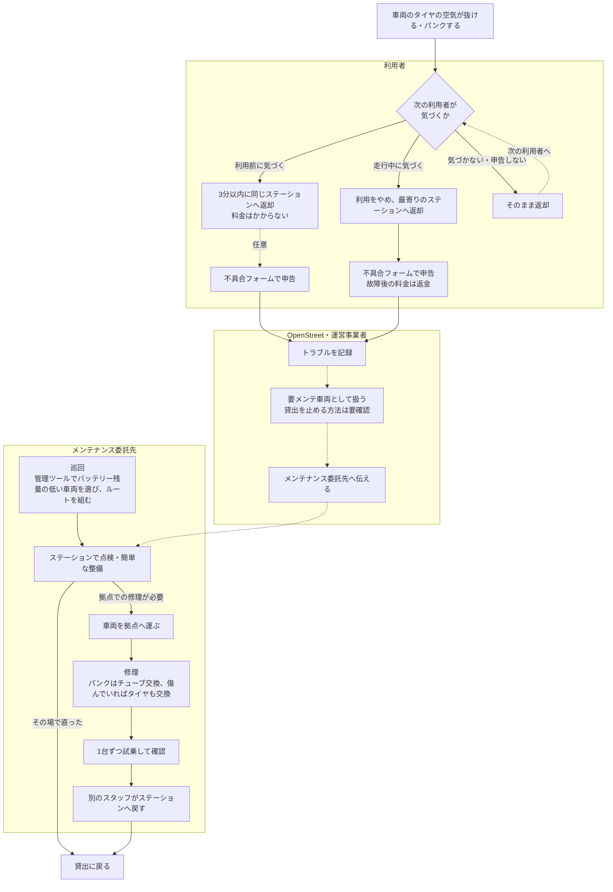

# 現状業務分析（As-Is業務フロー図）

## 0. 文書情報

| 項目 | 内容 |
|---|---|
| 資料No. | 07 |
| 版・状態 | 0.1 草案 |
| 更新日 | 2026-11-27 |
| 前提資料No. | 01 企画書（【仮】まだ草案で、2章・8章だけ記入済み。目的・スコープは T04 で決めるため、この資料の 6章は仮の見立て） |
| 関連する作業 | T03 対象事業者の現状業務を調べる（#4） |
| 承認者 | kei（作成者が taiga のため。承認のルールは資料01 8.2） |

**区分の書き方**　【事実】出典に書かれていること／【推測】出典から組み立てた想定／【要確認】わからないこと。出典の番号は 8章。

**この資料の前提**　私たちは対象事業者の関係者ではない。中身はすべて公開情報と想定から組み立てたもので、事業者に業務を確認したものではない。【推測】の箇所を、事業者が実際にそうしていると読まないこと。

---

## 1. 目的と調べ方

- 目的：対象事業者が「要メンテ車両」を見つけ、貸出から外し、修理し、貸出に戻すまでの現在の流れと、手間や損失が出ている箇所を説明できるようにする（T03 の完了の条件）。
- 対象：HELLO CYCLING（運営：OpenStreet株式会社）。2026-11-27 に taiga が決めた。
- 範囲：故障のうち、このプロジェクトの検知対象であるパンクを中心に見る。再配置・バッテリー交換は、パンクの発見や修理と同じ人・同じ巡回で行われるため、関係する範囲で触れる。
- 調べ方：公式のよくある質問・公式 note・自治体の資料・報道を読んだ（2026-11-27 時点）。

## 2. 対象事業者の概要

| 項目 | 内容 | 出典 |
|---|---|---|
| サービス | 電動アシスト自転車を中心としたシェアサイクル。アプリで予約・解錠・返却・決済する【事実】 | [1][2] |
| 規模 | 29都道府県、ステーション約11,700か所、車両約5万1,000台、会員約470万人（2025年8月時点）【事実】。2026年11月時点の値は【要確認】 | [3] |
| 事業の形 | OpenStreet がアプリ・決済・スマートロックなどの仕組み（プラットフォーム）を提供し、地域ごとの事業者が車両とステーションを用意して運営する形【事実】 | [4][5] |
| 車両の IoT | 車体に付けたスマートロックで、位置の把握・ロックのオンオフ・精算ができる。GPS と通信機能を持つ【事実】 | [4][6] |
| 整備の体制 | 整備はパートナー企業と協力して行う【事実】。例として、さいたま市周辺では芙蓉サービスが修理・バッテリー交換・再配置を受け持っている【事実】 | [7][8] |

- **ステーション**：自転車を借りたり返したりできる専用の駐輪場所。HELLO CYCLING ではどのステーションで借りても、別のステーションに返せる。
- **再配置**：ステーションごとの台数の偏りを、トラックなどで自転車を運んで直す作業。

## 3. 関係者と役割

| 関係者 | 要メンテ車両に関わる役割 | 区分 |
|---|---|---|
| 利用者 | 利用を始めたあとに車両を点検する。不具合に気づいたら利用をやめて返却し、アプリの「ヘルプ」の「自転車の不具合」フォームで知らせる | 【事実】[1][9] |
| OpenStreet（プラットフォーム） | アプリ・決済・コールセンターを提供する。利用者からのトラブルを記録し、ハードの問題ならメンテナンスにつなぐ | 【事実】[4][7] |
| 地域の運営事業者 | 車両とステーションを用意し、地域で運営する。施設と機材の整備も受け持つ（堺市の例） | 【事実】[4][10] |
| メンテナンス委託先 | 巡回してバッテリー交換・再配置・簡単な整備を行い、拠点で修理する。管理ツールで車両の状態を見る | 【事実】[8]。管理ツールで見られる項目のうち、バッテリー残量以外は【要確認】 |
| 自治体 | 協定を結んでステーション用地の確保や周知を行う。整備の作業そのものは行わない | 【事実】[10] |

【推測】OpenStreet・地域の運営事業者・メンテナンス委託先の分担は地域ごとに違う。地域の運営事業者が委託先を兼ねる地域もあると考えられる。

## 4. 現在の業務の流れ（As-Is）

### 4.1 全体の図

パンクした車両が見つかり、貸出に戻るまで。点線は【推測】または【要確認】の部分。

### 4.2 手順ごとの説明

| No. | 手順 | 誰が | 内容 | 区分・出典 |
|---|---|---|---|---|
| 1 | パンクが起きる | — | 1拠点の話では、パンクは前輪より後輪に多く、異物が刺さるより、空気が少ない状態でチューブがこすれて傷むものが多い | 【事実】[8] |
| 2 | 利用前の点検 | 利用者 | 利用を始めたあとに不具合がないか点検するよう案内されている。不具合があれば3分以内に同じステーションへ返せば料金はかからない | 【事実】[9][11] |
| 3 | 走行中の故障 | 利用者 | 利用をやめて最寄りのステーションへ返す。不具合フォームで知らせると、故障が起きてからの料金が返金される。動かせないほどの故障は電話窓口に相談する | 【事実】[1] |
| 4 | 申告 | 利用者 | フォームの必須項目は車両番号・ステーション名・故障の内容・状態・走れるかどうか（2021年時点）。利用前に見つけた場合の申告は「よろしければ」というお願いにとどまる | 【事実】[11][12] |
| 5 | 記録・連絡 | OpenStreet | コールセンターでトラブルを記録し、ハードの問題ならメンテナンスにつなぐ。データを可視化して委託先と協力しているとの説明もある | 【事実】[7]（2021年の説明）。今の連絡のしかたは【要確認】 |
| 6 | 貸出を止める | 運営側 | 申告された車両や修理待ちの車両を、どうやって予約・貸出の対象から外しているかは公開情報にない | 【要確認】 |
| 7 | 巡回 | 委託先 | 朝に充電済みバッテリーを積み、管理ツールでバッテリー残量の低い車両を確認してルートを組む | 【事実】[8] |
| 8 | 現地での点検・回収 | 委託先 | ステーションで点検と簡単な整備をし、パンク・ブレーキ・ライト・スタンドなど拠点での修理が要る車両を回収する | 【事実】二次情報 [13]（委託先の採用ページの要約。元のページは読めていない） |
| 9 | 修理 | 委託先 | パッチでふさがず、チューブを新品に交換する。タイヤが傷んでいればタイヤごと交換する。車輪の振れ取りは1日2〜3台 | 【事実】[8] |
| 10 | 試乗・再投入 | 委託先 | 修理後に1台ずつ外で試乗して確かめ、別のスタッフがステーションへ戻す | 【事実】[8] |

- **リム打ちパンク**：空気が少ないタイヤで段差を越えたとき、段差とリム（車輪の外側の金属の輪）の間でチューブが挟まれて破れるパンク。空気が少ないほど起きやすい [14]。
- **すれパンク**：空気が少ないとタイヤの中でチューブが動き、こすれて少しずつ傷んで穴があくパンク [8][15]。1拠点では、これが異物によるパンクより多かった。

### 4.3 数字で見えること（1拠点の例）

さいたま市周辺の委託先（芙蓉サービス）の取材記事（2025年6月）から。**この拠点・この時点だけの数字で、HELLO CYCLING 全体の故障率ではない。**

| 項目 | 値 | 出典 |
|---|---|---|
| 修理のうちパンクの割合 | 約半分 | [8] |
| 修理できるスタッフ | 5人 | [8] |
| 1人が1日に修理する台数 | 約10台 | [8] |
| チューブの発注 | ある夏に1か月200本（パンクが増えた時期） | [8] |
| バッテリー交換の1便の目標 | 120個（軽自動車に積める量に合わせる） | [8] |

【推測】5人×約10台で、この拠点は1日に約50台を修理している。その約半分がパンクなら、1日に20〜30台ほどのパンク修理をしている計算になる。営業日数・季節による差は不明なので、目安としてだけ使う。

## 5. 手間や損失が出ている箇所

| No. | 箇所（4.2 の手順） | 内容 | 誰に響くか | 区分・出典 |
|---|---|---|---|---|
| L1 | 発見（2〜4） | 要メンテ車両を見つける手段が、利用者の点検と申告に頼っている。申告は任意で、フォームは乗った車両を前提にした作りのため、通りがかりに気づいた故障は報告しにくいという声がある | 運営・利用者 | 【事実】[11][12]。申告されずに返される割合は【要確認】 |
| L2 | 次の利用者（2） | 申告されなかったパンク車両は、次の利用者が借りて初めて気づく。利用者は返却し、別の車両を探し直す手間を負う | 利用者 | 【事実】仕組み [9][11]。どれくらい起きているかは【要確認】 |
| L3 | 走行中の故障（3） | 走行中に気づくと、利用者は途中で降りて最寄りのステーションまで移動する。事業者は返金と問い合わせへの対応を負う | 利用者・運営 | 【事実】返金の仕組み [1]。件数・費用は【要確認】 |
| L4 | 利用の損失 | 整備不良の自転車が利用の損失を生んでいることが、堺市の資料で課題に挙げられている | 運営（売上）・自治体 | 【事実】[10]。損失の額は【要確認】 |
| L5 | 巡回（7） | 巡回のルートはバッテリー残量をもとに組まれている。パンクを車両側から知らせる仕組みは、公開情報では見当たらない。【推測】パンクは申告がない限り、巡回でたまたま見つかるのを待つことになる | 運営・委託先 | 【事実】[8]。パンクを把握する別の手段があるかは【要確認】 |
| L6 | 修理（9） | 1拠点では修理の約半分がパンクで、チューブ交換の手間と部品代がかかっている | 委託先・運営 | 【事実】[8] |
| L7 | 現地での作業（8） | 大型ステーションや臨時の駐輪場では、ロックの番号を1台ずつ見て目的の車両を探す手間がある。雨の日はスマートフォンの管理ツールが扱いにくい | 委託先 | 【事実】[8] |
| L8 | 空気圧の管理 | 空気が少ないまま使われることが、すれパンク・リム打ちパンクの原因になっている。公式も、空気が少ない車両を避けるよう利用者にお願いしている | 委託先・利用者 | 【事実】[8][13]。空気の補充をどの間隔で行っているかは【要確認】 |
| L9 | 安全 | 【推測】空気がほとんどない状態で走ると、段差でのリム打ちやハンドルの取られ方の変化で、転倒につながるおそれがある。HELLO CYCLING で実際に起きた事故の件数は公開情報にない | 利用者 | 【推測】一般論。件数は【要確認】 |

## 6. このプロジェクトへの示唆【仮】

T04（目的・スコープ・成功基準）などで決めるための材料。ここでは決めない。

- **検知対象の手応え**：1拠点の数字ではあるが、パンクは修理の中で最も多い故障であり、重度パンクを検知の対象にすることは現状の困りごとに合っている（L1・L5・L6）。
- **軽度・中度の扱い**：パンクの多くは空気が少ない状態から起きている（L8）。旧仕様書は軽度・中度（空気が少し抜けた状態）を「アラートを出してはいけない」としている（第6章）。空気の減りを早めに知らせればパンクそのものを減らせる可能性があり、スコープに入れるかは T04 で比較する。ただし MVP の期限（12/9）を考えると、まず重度に絞る理由も強い。
- **通信の前提**：旧仕様書は「返却時に Wi-Fi で Firebase へ送る」としている（第1章）。HELLO CYCLING のスマートロックは自前の通信を持つが、私たちは関係者ではないため使えない。ステーションに Wi-Fi があるかも【要確認】。通信方式は T31（全体構成と判定の置き場所）・資料19 で決める。
- **貸出を止める仕組み**：今のやり方（手順6）は公開情報でわからない。To-Be（資料14）では「検知したら予約・貸出の対象から外す」を自分たちのクラウドと管理Web・デモアプリで模擬する前提になる。
- **車両の違い**：HELLO CYCLING の車両は電動アシスト自転車で、普通の自転車より重い。実験で使う自転車の車種が振動の出方に影響しうるので、データ収集の計画（T15・資料09）で車種をどう扱うかを決める。

## 7. わかっていないこと（課題・リスク管理表の候補）

| 内容 | 影響 | 確かめ方・関係する作業 |
|---|---|---|
| 要メンテ車両を予約・貸出の対象から外す方法（手順6） | To-Be の「自動除外」が今と比べてどれだけ手間を減らすか説明できない | 公開情報では難しい。想定で進めることを T04 で明記する |
| パンクした車両が申告されずに返される割合、次の利用者が借りてしまう頻度 | 期待する効果（資料01 5章）を数字で示せない | 公開情報では難しい。効果は「どの手間が減るか」で示し、数字は想定と明記する（T04） |
| HELLO CYCLING 全体のパンクの件数・修理費・稼働停止の日数 | 費用対効果を示せない | 同上 |
| ステーションで使える通信（Wi-Fi の有無） | 旧仕様書の「返却時 Wi-Fi 同期」が成り立たないおそれ | T31・資料19 |
| 空気の補充や定期点検の間隔 | 「巡回で見つかるまでの時間」を見積もれない | 公開情報では難しい |
| 2026年11月時点の規模（ステーション数・台数） | 企画書の背景の数字が古くなる | 企画書を承認に出す前（T07）に公式発表を見直す |

## 8. 出典

閲覧日はすべて 2026-11-27。

| No. | 出典 | 使った内容 |
|---|---|---|
| [1] | [HELLO CYCLING よくある質問（水戸市が掲載した資料）](https://www.city.mito.lg.jp/uploaded/attachment/63415.pdf) | 走行中の故障時の対応、返金、ヘルプのフォーム |
| [2] | [HELLO CYCLING（App Store）](https://apps.apple.com/JP/app/id1216653677) | 借り方・返し方、対応しているサービス |
| [3] | [OpenStreetと秋谷鉄工所が業務提携（エキサイトニュース、2025-08-18）](https://www.excite.co.jp/news/article/AMP_473003/) | 規模（都道府県数・ステーション数・台数・会員数） |
| [4] | [シェアサイクルの展開をアシストする「IoT自転車」（MCPC award 2018 事例）](https://www.mcpc-jp.org/jirei/pdf/1903_mcpc_p21_openstreet.pdf) | 事業の形、車体の IoT の機能、OpenStreet が提供するもの |
| [5] | [OpenStreet 事例（LINEヤフー for Business）](https://www.lycbiz.com/jp/case-study/line-mini-app/openstreet) | 地域パートナーと分業する形 |
| [6] | [OpenStreet 事例（イプロス、fujitass の事例紹介）](https://pr.mono.ipros.com/en/fujitass/product/detail/2001626734) | スマートロックの GPS・通信機能 |
| [7] | [故障したときはどうなる？ HELLO CYCLING（エキサイトニュース、2021-07-29）](https://www.excite.co.jp/news/article/AllNightNippon_305326/) | コールセンターでの記録、パートナーとの整備、データの可視化 |
| [8] | [【前編】HELLO CYCLINGを支える縁の下の力持ち！～芙蓉サービス編～（HELLO CYCLING 公式 note、2025-06-20）](https://note.com/openstreet/n/n7c3ca6783edc) | 委託先の業務、巡回、修理・試乗・再投入、パンクの割合と原因、人数と台数、現場の手間 |
| [9] | [会員登録・利用案内（松戸市）](https://www.city.matsudo.chiba.jp/kurashi/douro/jitensha/sharecycle.files/kaiintourokuriyouannai.pdf) | 利用開始後の点検、3分以内の返却 |
| [10] | [堺市シェアサイクル事業の本格運用の開始について（堺市）](https://www.city.sakai.lg.jp/kita/torikumi/jichikai/ichiran/teireikai202211.files/11saikuru2.pdf) | 実証実験の課題（整備不良による利用の損失）、市と運営主体の役割 |
| [11] | [HELLO CYCLING よくある質問（デモサイト。検索結果の抜粋のみ参照）](https://demo03.hellocycling.jp/faq/) | 利用前に見つけた故障の対応、申告のお願い |
| [12] | [HELLO CYCLINGの不具合申告フォームが使いづらい理由（個人の note、2021-11-19）](https://note.com/keitotetsu/n/ncf1970e09d66) | フォームの入力項目、報告しにくい点（利用者の意見） |
| [13] | [シェア車両は何が壊れやすい？（サイクルショップ金太郎）](https://3196kintarou.com/knowledge/bicycle-industry/articles/share-cycle-common-failures/) | 現地点検と回収の分け方（委託先ページの要約）、公式のパンク予防の案内（二次情報） |
| [14] | [国民生活センター 相談解決のためのテストから（2018-11-07）](https://www.kokusen.go.jp/news/data/n-20181107_2.html) | リム打ちパンクの起き方 |
| [15] | [自転車のパンク、7割は防げる？（乗りものニュース）](https://trafficnews.jp/post/55698) | 空気圧の低下とパンクの関係（一般論） |

## 改訂履歴

| 版 | 日付 | 内容 |
|---|---|---|
| 0.1 | 2026-11-27 | 初版（T03）。対象を HELLO CYCLING とし、公開情報から As-Is の流れと手間・損失の箇所を整理 |
