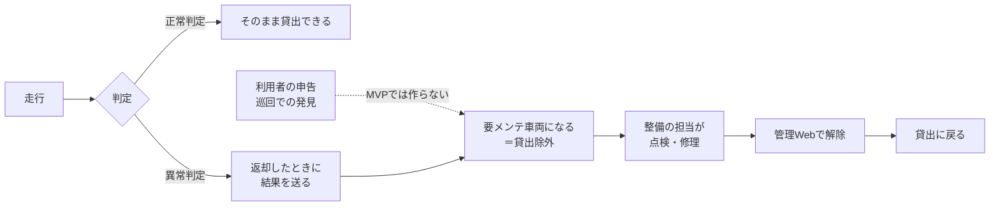

# 用語集

## 0. 文書情報

| 項目 | 内容 |
|---|---|
| 資料No. | 02 |
| 版・状態 | 0.3 草案（T05 で中心の用語の定義を決めた） |
| 更新日 | 2026-11-27 |
| 前提資料No. | 01 企画書（【仮】まだ草案） |
| 関連する作業 | T03（#4）、T04（#5）、T05 用語の定義をそろえる（#6）、T07 関門：企画の承認（#8） |

**この資料の使い方**　資料・Issue・会話では、この資料の定義どおりに用語を使う。新しい用語が出たら、作業の中でここに足す。定義を変えるときは改訂履歴に残し、意味が大きく変わるときは ADR にも残す。

**区分の書き方**　【決定】定義が決まった／【仮】草案の定義で、あとの作業で見直す／【未定】定義を決めていない。値（空気圧の範囲など）だけが【仮】の場合は、定義の中にそう書く。

## 1. 用語の考え方（T05 で決めたこと）

T05（2026-11-27）で次の4つを決めた（ADR-011）。

1. **タイヤの実際の状態と、システムの判定の結果を別の言葉にする。** 実際の状態は「正常・軽度・中度・重度パンク」、システムの結果は「異常判定・正常判定」と呼ぶ。「重度パンクと判定した」とは書かず、「異常判定した」と書く。異常判定には誤検知も含まれるため。
2. **重度パンクは、意味を状態で書き、実験・評価でのラベルは空気圧で付ける。** 現場の人にも伝わる意味と、実験で測れる基準を両方持つため。
3. **要メンテ車両は、きっかけを問わない。** 異常判定・利用者の申告・巡回での発見のどれがきっかけでも、点検・修理が要るとして貸出除外した車両を要メンテ車両と呼ぶ。きっかけは「要メンテの理由」として持つ。MVP で作るのは、異常判定がきっかけのものだけ。
4. **予約・貸出の対象から外すことは「貸出除外」にそろえる。** 「貸出停止」は使わない。

実際の状態と判定の結果の組み合わせは、次のように呼ぶ。

| 実際の状態 ＼ 判定 | 異常判定 | 正常判定 |
|---|---|---|
| 重度パンク | **検知**（正しく見つけた） | **見逃し** |
| 正常・軽度・中度 | **誤検知** | 正しく正常と判定した |

要メンテ車両になってから貸出に戻るまでの流れと用語の関係は、次のとおり。

## 2. 用語一覧

### 2.1 タイヤの状態

| 用語 | 定義 | 区分 | 出た作業・資料 |
|---|---|---|---|
| パンク | このプロジェクトでは、穴があいているかどうかや原因を問わず、タイヤの空気が抜けた状態を指す。ふつうの意味（穴があいて空気が抜けること）より広い | 【決定】 | T05 |
| タイヤの状態 | タイヤの実際の状態を表す4段階：正常・軽度・中度・重度パンク（2.2 の表）。システムの判定の結果（2.3）とは別の言葉 | 【決定】 | T05、旧仕様書 第6章 |
| 正常 | 空気が規定空気圧どおりに入っている状態。正常判定されるべき状態 | 【決定】（空気圧の範囲は【仮】） | T05 |
| 軽度 | 空気が少し抜け、タイヤがやや柔らかい状態。異常判定してはいけない状態として扱う（ADR-008） | 【決定】（空気圧の範囲は【仮】） | T05、ADR-008 |
| 中度 | 空気がはっきり抜けているが、重度パンクほどではない状態。異常判定してはいけない状態として扱う（ADR-008） | 【決定】（空気圧の範囲は【仮】） | T05、ADR-008 |
| 重度パンク | 空気がほぼ抜け、そのまま走ると段差でリムに強い衝撃が来る（リム打ちパンクが起きやすい）状態。このシステムが検知する対象（ADR-008）。実験・評価でのラベルは空気圧で付ける（2.2） | 【決定】（空気圧の範囲は【仮】） | T04、T05、ADR-008 |
| 規定空気圧 | タイヤの側面などに表示されている、入れるべき空気圧の範囲。「正常」の基準になる。実験に使う車両の値は【要確認】 | 【決定】 | T05 |
| 空気圧（kPa） | タイヤの中の空気の圧力。空気入れなどのゲージで測る、大気圧との差の値（ゲージ圧）。kPa（キロパスカル）は圧力の単位で、100 kPa はおよそ1気圧 | 【決定】 | T05 |
| リム打ちパンク | 空気が少ないタイヤで段差を越えたとき、段差とリム（車輪の外側の金属の輪）の間でチューブが挟まれて破れるパンク。空気が少ないほど起きやすい | 【仮】 | T03、資料07 |
| すれパンク | 空気が少ない状態で走ると、タイヤの中でチューブが動いてこすれ、少しずつ傷んで穴があくパンク | 【仮】 | T03、資料07 |

### 2.2 タイヤの状態と、実験・評価のラベルの空気圧

| タイヤの状態 | 意味 | ラベルの空気圧【仮】 | このプロジェクトでの扱い |
|---|---|---:|---|
| 正常 | 規定空気圧どおり | 300〜400 kPa | 正常判定されるべき |
| 軽度 | やや柔らかい | 200〜250 kPa | 異常判定してはいけない（アラートの対象にしない） |
| 中度 | はっきり空気が抜けている | 100〜150 kPa | 異常判定してはいけない（アラートの対象にしない） |
| 重度パンク | 空気がほぼ抜けている | 0〜50 kPa | 検知の対象 |

- 空気圧の値は旧仕様書 第6章の目安で、【仮】。ラベルの付け方（範囲の境目、測る道具、測るタイミング）は T15 データ収集の計画（資料09）で確定する。
- 表の範囲にはすき間がある（50〜100、150〜200、250〜300 kPa）。すき間に入った走行をどう扱うかは決まっていない（資料04 K-015）。
- 正常の 300〜400 kPa は、実験に使う車両の規定空気圧と合っているか【要確認】（資料04 K-015）。

### 2.3 判定と評価

| 用語 | 定義 | 区分 | 出た作業・資料 |
|---|---|---|---|
| 異常判定 | システムが、走行1回について「重度パンクの疑いがある」と判定した結果。実際に重度パンクかどうかとは別（誤検知を含む）。旧仕様書の FAULT_LATCHED（異常を確定して残した状態）に当たる | 【決定】 | T05 |
| 正常判定 | システムが、走行1回について異常判定しなかった結果 | 【決定】 | T05 |
| 検知 | 実際に重度パンクの走行を、異常判定できたこと。異常判定された車両を広く指すときは「検知した車両」ではなく「異常判定した車両」と書く | 【決定】 | T05 |
| 見逃し | 実際に重度パンクの走行を、正常判定してしまうこと | 【決定】 | T05 |
| 誤検知 | 重度パンクでない走行（正常・軽度・中度）を、異常判定してしまうこと。旧仕様書の False Positive | 【決定】 | T05 |
| 走行（走行1回） | 実験では、試験コースを1回走ること。実際の運用で何を1回とするか（貸出から返却までの1回の利用 など）は【未定】で、T23・T35 で決める（資料04 K-016） | 【仮】 | T04、T05 |
| 走行単位 | 走行1回を1件として数えること。1回の走行を細かく区切った区間を、1件ずつ数えることはしない | 【決定】 | T04、資料01 7.1 |
| 検知率 | 重度パンクの走行のうち、異常判定できた割合。旧仕様書の Recall_run。目標値と合否の判定方法は T08 で確定する | 【決定】（目標値は【仮】） | T04、資料01 7.1 |
| 誤検知率 | 重度パンクでない走行のうち、異常判定した割合。旧仕様書の FPR_run。正常の走行だけで数えるもの（FPR_strict）と、軽度・中度も含めて数えるもの（FPR_field）がある。合否には FPR_strict を使う予定で、T08 で確定する | 【決定】（目標値は【仮】） | T04、資料01 7.1 |
| 再生（デモ） | 実験で録った走行データを、デバイスの判定に流し込んで動かすこと。MVP のデモで使う | 【仮】 | T04、資料01 6.1、ADR-010 |

旧仕様書の SUSPECT（疑わしいが確定はしない状態。2回続けて疑わしいときに確定する「2走行ルール」に使う）を使うかどうかは、T23・T28 で決める。使うことになったら、ここに用語を足す。

### 2.4 要メンテ車両と貸出除外

| 用語 | 定義 | 区分 | 出た作業・資料 |
|---|---|---|---|
| 要メンテ車両 | 点検・修理が必要だとして、貸出除外した車両（要メンテは「要メンテナンス」の略）。きっかけは問わず、「要メンテの理由」として持つ。解除されるまで要メンテ車両のまま。要メンテ車両であることは、実際に壊れていることを意味しない（誤検知を含む）。MVP で作るのは、異常判定がきっかけのものだけ。旧仕様書の MAINTENANCE_REQUIRED に当たる | 【決定】 | T03、T05、資料07 |
| 要メンテの理由 | 車両が要メンテ車両になったきっかけ。例：異常判定、利用者の申告、巡回での発見。MVP で扱うのは異常判定だけ。どの理由を持つかは T26・T36 で決める | 【決定】（理由の種類は【仮】） | T05 |
| 貸出除外 | 車両を、予約と貸出の両方の対象から外すこと。車両が要メンテ車両になると貸出除外される。MVP では、自分たちで用意する予約の仕組み（クラウド）が自動で行う | 【決定】 | T03、T05、資料体系一覧 |
| 貸出停止 | 使わない言葉。貸出除外と同じ意味で、旧仕様書 第35章で使われている（資料07 では「貸出を止める」と書いている）。新しく書く資料では「貸出除外」にそろえる | 【決定】 | T03、T05 |
| 解除 | 整備の担当が管理Webで、要メンテ車両を元に戻す操作。点検・修理が済んだとき、誤検知だったときに行う。解除すると貸出除外が終わる。旧仕様書の「異常解除」 | 【決定】 | T04、T05、資料01 6.1 |
| 貸出に戻る | 解除によって、車両が予約・貸出の対象に戻ること。「復帰」とも書く | 【決定】 | T05 |
| 取り付け異常 | デバイスの取り付けの傾きのずれや緩みが、決めた範囲を超えた状態。旧仕様書の MOUNT_FAULT。MVP では「余裕があればやる」（資料01 6.1）。要メンテの理由に含めるかは T28 で決める（資料04 K-017） | 【仮】 | T04、T05 |
| 取り付けの傾き | デバイスが、決めた向きからどれだけ傾いて付いているか。止まっているときの重力の向きから求める。旧仕様書の tilt_angle_deg | 【仮】 | T04、資料01 6.1 |

### 2.5 シェアサイクルの業務と関係者

| 用語 | 定義 | 区分 | 出た作業・資料 |
|---|---|---|---|
| ステーション | シェアサイクルの自転車を借りたり返したりできる専用の駐輪場所。ポート、サイクルポートとも呼ばれる。どのステーションで借りても、別のステーションに返せる | 【仮】 | T03、資料07 |
| 返却 | 利用者が車両をステーションに返し、施錠すること。デバイスが判定の結果をクラウドへ送るきっかけになる（通信方式は T31・T32） | 【仮】 | T04、T05 |
| 利用者の申告 | 利用者が、乗った車両の不具合をアプリのフォームで知らせること。任意で行う（資料07） | 【仮】 | T03、T05、資料07 |
| 整備の担当 | 要メンテ車両を点検・修理し、解除する人。対象事業者では委託先などのパートナー（資料07）。MVP では管理Webを使う人。管理Webの権限は T37 で決める | 【仮】 | T03、T04、資料07 |
| 再配置 | ステーションごとの自転車の台数の偏りを、トラックなどで運んで直す作業 | 【仮】 | T03、資料07 |
| バッテリー交換 | 電動アシスト自転車のバッテリーを、巡回して充電済みのものに取り替える作業 | 【仮】 | T03、資料07 |
| 拠点修理 | ステーションではその場で直せない車両を、整備の拠点（作業場）に運んで修理すること。対になるのは、ステーションで行う点検・簡単な整備 | 【仮】 | T03、資料07 |

### 2.6 システムの構成

資料01 4.1 の構成要素。どこで何をするかの細部は、T31 以降の設計で決める。

| 用語 | 定義 | 区分 | 出た作業・資料 |
|---|---|---|---|
| デバイス | 車両に取り付ける、センサー付きの小さな機器。振動を測り、判定の結果を残しておき、返却したときに送る。判定をデバイスで行うかは T31 で決める | 【仮】 | T04、資料01 4.1 |
| クラウド | 判定の結果を受け取り、車両を要メンテ車両にして貸出除外する仕組み。Firebase を使う予定。自分たちで用意する予約の仕組みもここに置く | 【仮】 | T04、資料01 4.1 |
| 管理Web | 整備の担当が、要メンテ車両の一覧と状態を確かめ、解除するための Web 画面 | 【仮】 | T04、資料01 4.1 |
| デモアプリ | 利用者から見た変化（要メンテ車両が予約できない など）を見せるために、利用者向けアプリをまねて作るアプリ。HELLO CYCLING の利用者向けアプリは使えないため（ADR-007） | 【仮】 | T04、資料01 4.1 |

## 3. 旧仕様書の用語との対応

旧仕様書（PROJECT_SPEC 第5版）の用語を、このプロジェクトではこう呼ぶ。

| 旧仕様書 | この用語集 |
|---|---|
| 重度パンク（空気圧 0〜50 kPa 程度） | 重度パンク（意味は状態で書き、空気圧はラベルの基準） |
| 正常／軽度／中度／重度（状態レベル、第6章） | タイヤの状態 |
| FAULT_LATCHED | 異常判定（異常を確定して残した状態） |
| NORMAL（センサー判定） | 正常判定 |
| SUSPECT | 【未定】（T23・T28 で使うかを決める） |
| Recall_run | 検知率 |
| FPR_run・FPR_strict・FPR_field | 誤検知率 |
| False Positive | 誤検知 |
| MAINTENANCE_REQUIRED | 要メンテ車両 |
| 貸出対象から除外／貸出停止 | 貸出除外 |
| 異常解除 | 解除 |
| AVAILABLE | 貸出に戻った状態（車両の状態の名前は T25・T36 で決める） |
| MOUNT_FAULT | 取り付け異常 |
| tilt_angle_deg | 取り付けの傾き |

車両の状態（貸出できる、予約中、利用中、要メンテ、点検中 など）の名前と、状態の移り変わりは、T25（To-Be）と T36（クラウドの設計）で決める。決まったら用語集に足す。

## 改訂履歴

| 版 | 日付 | 内容 |
|---|---|---|
| 0.1 | 2026-11-27 | 初版（T03）。T03 で出た用語8件を登録 |
| 0.2 | 2026-11-27 | T04 で出た用語4件（走行単位・検知率・誤検知率・再生）を 1.3 に登録 |
| 0.3 | 2026-11-27 | T05 で中心の用語（重度パンク・要メンテ車両・貸出除外）と関連する用語を定義した。用語の考え方（1章）と旧仕様書との対応（3章）を足し、章立てを分野ごとに組み直した（ADR-011） |
